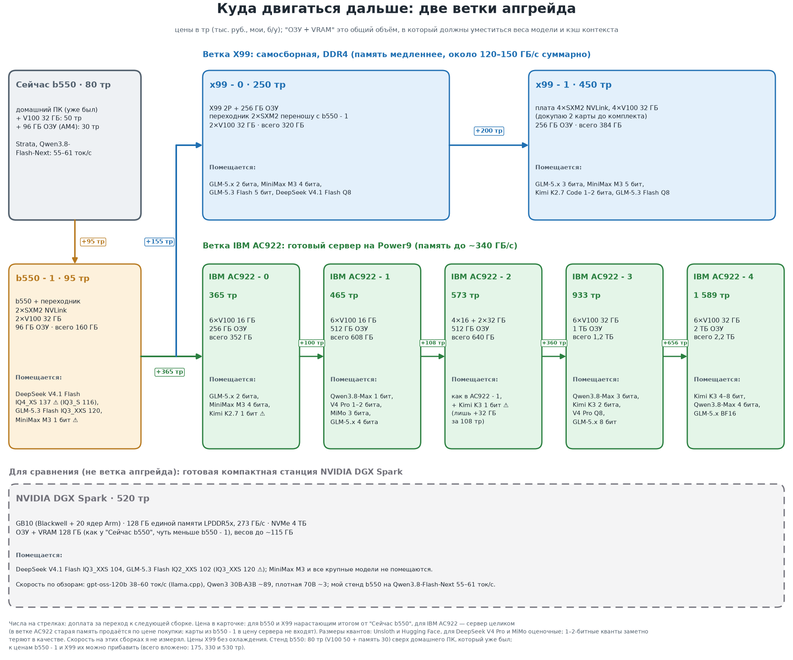

# Домашний ИИ и пути развития. Одна Tesla V100 32 ГБ в 2026 году: сколько токенов выжимают локальные модели, на какие грабли я наступил и куда расти дальше

Старая серверная карта Tesla V100 на 32 ГБ до сих пор стоит как одна современная видеокарта среднего класса, а памяти у неё столько, что в неё целиком помещается модель на 30 млрд параметров. Я собрал на ней домашний сервер для локальных моделей, прогнал замеры скорости и по дороге выяснил, что половина моих "выводов" была ошибками измерения. Ниже цифры, методика, грабли и два примера из реальных рабочих проектов, где локальные модели помогали (и где не помогли).

Все скрипты и сырые результаты лежат в репозитории: [github.com/DmNep/llm-bench-v100](https://github.com/DmNep/llm-bench-v100).

## Зачем вообще локальные модели

В моих проектах причины были разные, и ни в одном из них это не была "экономия на подписке":

- **Приватность.** В проекте по восстановлению данных 1С из повреждённого файла базы (после шифровальщика) в данных были настоящие персональные данные живых людей. Правило проекта: агентам по умолчанию дают работу со структурами, смещениями и идентификаторами, а не со сводными таблицами, и эти данные без необходимости не уходят в облачные сервисы. Локальная модель работает на моём компьютере, поэтому данные не приходится отправлять в облако: разбор идёт там же, где они лежат.
- **Пропускная способность.** Задач вида "есть ли в повреждённом файле данные про X" были десятки, каждая отрицательная проверка стоит часы, и перебор удобно отдать локальному воркеру.
- **Чувствительное сырьё.** В другом проекте нужно было разобрать видеозапись с голосовыми пояснениями: звук я распознавал локально, на своей машине, чтобы он никуда не уходил.
- **Разработка и тестирование на 1С, криптография и криптовалюты.** Данные, с которыми я работаю при проектировании, разработке и тестировании функционала на 1С, а также в проектах по криптографии и криптовалюте, чувствительные и никуда не должны уходить. Поэтому у меня стоит локальная модель (подробнее ниже).

## Стенд

- GPU: Tesla V100-SXM2 32 ГБ (архитектура Volta, compute capability 7.0) на переходной плате SXM2 → PCIe. Драйвер NVIDIA 580.
- ОС: Ubuntu 26.04. Оперативная память: в основных замерах Ollama и llama.cpp 30 ГБ (`free -h` показывает 28Gi, потому что Linux считает в гибибайтах: 1 ГиБ = 1,074 ГБ; в статье я везде перевёл в гигабайты; это важно, см. ниже), для Strata я потом докупил и поставил 96 ГБ (2×32 + 2×16 ГБ, DDR4-2666), см. раздел про Strata. Процессор у основной машины слабый (4 ядра), у стенда для Strata Ryzen 7 PRO 4750G (8 ядер), карта на PCIe 3.0 x16.
- Софт: два движка на одних и тех же файлах GGUF: Ollama 0.34.2 и отдельно собранный llama.cpp (`llama-server`; CUDA 12.9, gcc-14, флаг `CMAKE_CUDA_ARCHITECTURES=70`). llama.cpp понадобился сначала для 128K контекста, потом я прогнал на нём все модели.
- Особенность: сервером я периодически управлял без SSH, через звуковой канал. Поначалу VPN часто ронял сеть, и обычное подключение пропадало, а звук между аудио-выходом ноутбука и входом сервера работал всегда (команды передаются как звук, около 1200 бод). Это не обязательная часть истории, но объясняет, почему часть команд я писал короткими и без интерактива. Сам инструмент я вынес в отдельный проект: [github.com/DmNep/x_connector](https://github.com/DmNep/x_connector).

## Как я измерял

Скрипт `bench.ps1` ходит в API Ollama и для каждой модели и каждого размера запроса делает три прогона:

- в каждом прогоне случайный текст и случайный идентификатор в начале, чтобы кэш промпта Ollama не превратил чтение запроса в "мгновенное" (это самая частая ошибка в чужих замерах);
- размер запроса берётся из `prompt_eval_count` ответа сервера, а не "на глаз по словам": если Ollama обрезала запрос, строка помечается и в медианы не идёт;
- генерация фиксированной длины (128 токенов) без случайности: модель всегда берёт самое вероятное продолжение;
- итоговое число — это медиана из трёх повторов; между моделями — предыдущая выгружается из памяти.

Для llama.cpp то же самое делает `bench-llamaserver.ps1` через эндпоинт `/completion` (поля `tokens_evaluated` и `timings`, кэш промпта выключен). Окна те же, что у соответствующих тегов Ollama. Кэш ключей и значений (KV) у моделей на 32K стоит в f16, как по умолчанию у Ollama; у Qwen3-30B на 128K пришлось взять q8_0, иначе она не влезает в карту (подробнее ниже, это важно для сравнения).

## Результаты

Как читать таблицы. **Токен** — это кусочек текста, на которые модель режет всё, что читает и пишет (около 3–4 символов английского текста; русские слова в моём тесте давали около 2 токенов на слово). **Окно** — это максимальный размер контекста, на который модель настроена (в Ollama параметр `num_ctx`, в llama.cpp `-c`): сколько токенов в сумме помещается в "памяти" модели, считая запрос и ответ. **Столбцы 1K…115K** — это размер запроса в тесте, то есть сколько контекста уже заполнено в момент замера (1K около 1 100 токенов, 67K около 66 700, 115K около 118 000). Прочерк значит, что запрос такого размера не влезает в окно модели.

Движки идут рядом, на одних и тех же файлах GGUF. Строка "*разница*" — это отклонение llama.cpp от Ollama в процентах: минус значит, что llama.cpp медленнее, плюс что быстрее.

Скорость **генерации** (токенов в секунду) при запросе указанного размера в контексте:

| Модель | Движок | 1K | 4K | 16K | 25K | 33K | 67K | 115K |
|---|---|---:|---:|---:|---:|---:|---:|---:|
| llama3.2:1b (Q8_0) | Ollama | 288 | 280 | 248 | 223 | - | - | - |
|  | llama.cpp | 303 | 292 | 245 | 226 | - | - | - |
| | *разница* | +5% | +5% | −1% | +1% | - | - | - |
| Qwen3-30B-A3B-Thinking (Q4_K_M) ⁴ | Ollama | 133 | 125 | 105 | 94,8 | 86,2 | 63,7 | - |
|  | llama.cpp ³ | 110 | 99,0 | 69,8 | 59,0 | 50,7 | 32,6 | 21,5 |
| | *разница* | −17% | −21% | −33% | −38% | −41% | −49% | - |
| Gemma 4 31B (Q4_K_M) | Ollama ¹ | 56,4 | 54,2 | 50,9 | 49,6 | 45,5 | - | - |
|  | llama.cpp | 29,9 | 29,2 | 28,1 | 27,5 | 26,7 | - | - |
| | *разница* | −47% | −46% | −45% | −45% | −41% | - | - |
| Qwen3-Coder-30B-A3B (Q8_0) | Ollama | 45,5 | 44,4 | 41,6 | 40,1 | - | - | - |
|  | llama.cpp ² | 35,7 | 36,4 | 34,0 | 32,9 | - | - | - |
| | *разница* | −22% | −18% | −18% | −18% | - | - | - |
| Gemma 4 31B QAT (Q4_0) | Ollama | 33,8 | 32,3 | 31,0 | 30,2 | - | - | - |
|  | llama.cpp | 33,4 | 32,5 | 31,1 | 30,3 | - | - | - |
| | *разница* | −1% | +1% | 0% | 0% | - | - | - |

¹ Цифры Ollama для этого тега недостоверны: она показывает 2,1 ГБ в памяти при весе файла 20,4 ГБ, а скорость 56 ток/с выше физического предела плотной 31B-модели на 900 ГБ/с (около 44 ток/с). Тот же файл на llama.cpp дал 30 ток/с и 23,7 ГБ видеопамяти, и это правдоподобно. Почему Ollama показала другое, выяснить не удалось.

² Файл Qwen3-Coder в Q8_0 весит около 32 ГБ и вместе с кэшем в карту не влезает: `llama-server` падает с ошибкой выделения буфера. Здесь 8 слоёв экспертов оставлены в оперативной памяти (`--n-cpu-moe 8`); число слоёв не подбиралось, при меньшем числе может быть быстрее.

³ Настройки кэша разные: Ollama держит KV-кэш в f16 (31 ГБ видеопамяти на окно 131072), а llama.cpp я запускал с q8_0 (24,9 ГБ), иначе окно 131072 вместе с моделью в карту не влезает. Работа с квантованным кэшем на длинном контексте стоит скорости, поэтому разрыв растёт с размером запроса. Сравнение здесь — это сравнение "движок + настройки", а не одних движков. 115K (около 118 тысяч токенов) я мерил только на llama.cpp.

⁴ "A3B" в названии означает 3 млрд активных параметров из 30: это модель типа MoE ("смесь экспертов"), на каждое слово у неё работает лишь небольшая часть параметров. Подробнее об этом ниже, в пояснении после таблиц.

Скорость **чтения запроса** (prefill), токенов в секунду:

| Модель | Движок | 1K | 4K | 16K | 25K | 33K | 67K | 115K |
|---|---|---:|---:|---:|---:|---:|---:|---:|
| llama3.2:1b (Q8_0) | Ollama | 18 181 | 19 476 | 13 160 | 10 721 | - | - | - |
|  | llama.cpp | 16 791 | 16 447 | 11 497 | 9 411 | - | - | - |
| | *разница* | −8% | −16% | −13% | −12% | - | - | - |
| Qwen3-30B-A3B-Thinking (Q4_K_M) | Ollama | 1 298 | 1 311 | 1 170 | 1 074 | 985 | 743 | - |
|  | llama.cpp ³ | 1 177 | 1 309 | 1 163 | 1 056 | 972 | 729 | 529 |
| | *разница* | −9% | 0% | −1% | −2% | −1% | −2% | - |
| Gemma 4 31B (Q4_K_M) | Ollama ¹ | 409 | 553 | 554 | 518 | 484 | - | - |
|  | llama.cpp | 497 | 600 | 576 | 528 | 493 | - | - |
| | *разница* | +21% | +8% | +4% | +2% | +2% | - | - |
| Qwen3-Coder-30B-A3B (Q8_0) | Ollama | 812 | 989 | 933 | 876 | - | - | - |
|  | llama.cpp ² | 414 | 524 | 524 | 502 | - | - | - |
| | *разница* | −49% | −47% | −44% | −43% | - | - | - |
| Gemma 4 31B QAT (Q4_0) | Ollama | 571 | 698 | 676 | 624 | - | - | - |
|  | llama.cpp | 484 | 600 | 574 | 527 | - | - | - |
| | *разница* | −15% | −14% | −15% | −16% | - | - | - |

**Ollama или llama.cpp?** На плотных моделях с кэшем f16 генерация почти одинакова: QAT-версия Gemma и маленькая llama3.2:1b отличаются на 1–5%. Заметная разница там, где отличаются настройки или где цифры подозрительны:

- **Qwen3-30B на большом окне: у Ollama быстрее генерация**, и разрыв растёт с длиной запроса (−17% на 1K, −49% на 67K), а чтение запроса почти одинаковое (в пределах 2%). Причина в кэше q8_0 у llama.cpp (см. сноску ³). Обратная сторона: llama.cpp честно вернул ошибку, когда запрос не влез, а Ollama молча обрезает его вдвое (см. ниже).
- **Qwen3-Coder: у Ollama быстрее и генерация (−18…−22%), и чтение запроса (почти вдвое)**, но у меня часть экспертов ушла в оперативную память, и это настройка, а не свойство движка.
- **Gemma 4 31B Q4_K_M:** по Ollama она "быстрее" вдвое, но это цифры из сноски ¹, которым верить нельзя.

Что из этого видно:

- **Мало активных параметров = быстро.** Модели бывают двух устройств. У плотной модели (такая Gemma 31B) на каждое слово работают все параметры. MoE (Mixture of Experts, "смесь экспертов") состоит из множества небольших блоков-"экспертов", и на каждое слово включаются лишь несколько из них, остальные в этот момент простаивают. Поэтому Qwen3-30B-A3B (MoE: 30 млрд параметров всего, из них 3 млрд активных, это и значит "A3B" в названии) выдаёт 110–133 ток/с, а плотная Gemma 31B 30–34 ток/с при сопоставимом размере файла. На такой карте MoE-модели выигрывают в 3–4 раза.
- **Длинный контекст стоит скорости.** У Qwen3-Thinking в Ollama генерация падает с 133 до 64 ток/с при росте запроса с 1K до 67K, а чтение запроса с 1 300 до 743 ток/с; на llama.cpp с кэшем q8_0 с 110 до 21,5 ток/с на запросе в 118 тысяч токенов. Плотные модели замедляются мягче: у Gemma 4 31B с 30 до 27 ток/с на 33K.
- **Квант Q8 не бесплатен.** Qwen3-Coder в Q8_0 (32,5 ГБ) почти заполняет карту и даёт 36–46 ток/с на коротком запросе (в зависимости от движка); Qwen3-Thinking в Q4_K_M при том же числе параметров вдвое-втрое быстрее. Эти две модели разные, поэтому прямо сравнивать их нельзя, но порядок величин показывает цену точности.

## Strata: MoE в 125 млрд параметров на одной V100

Отдельный движок [Strata](https://github.com/Niko1221/Strata) запускает модель Qwen3.8-Flash-Next (MoE, около 125 млрд параметров, около 6 млрд активных) на обычной видеокарте. Идея: внимание и самые частые эксперты лежат в видеопамяти (у меня кэш на 9 489 экспертов, 23 ГБ), остальные эксперты в оперативной памяти, а недостающие подкачиваются по PCIe. Поэтому скорость сильно зависит от того, **сколько экспертов помещается в оперативку**.

Я мерил три конфигурации одного и того же сервера:

| Конфигурация | Модель | Чтение запроса, ток/с | Генерация, ток/с |
|---|---|---:|---:|
| 64 ГБ DDR4-2133, 4 ядра, V100 на PCIe x8 | IQ2_XS (2 бита, 39 ГБ) | 595–1 570 (на 1K–25K) | 71–73 |
| 48 ГБ ОЗУ, бюджет экспертов 22,5 ГБ | UD-Q4_K_XL (4 бита, 111 ГБ) | 87 (1K), 547 (25K) | 28–40 |
| **96 ГБ ОЗУ, все эксперты в памяти** | **UD-IQ4_XS** (4 бита, 94 ГБ) | 310 (1K), 1 236 (25K), 1 215 (117K), 1 065 (239K) | **55–61** (до 66 с размышлением) |
| 96 ГБ ОЗУ, бюджет 69 из 77 ГБ | UD-Q4_K_XL | 229, 1 112, 1 110, 982 | 47–52 |

**Что такое "бюджет".** Это настройка Strata `--resident-budget-gib`: сколько гигабайт весов экспертов она постоянно держит в оперативной памяти. Всё, что в бюджет не вошло, остаётся в файлах модели на диске (NVMe) и читается оттуда по мере надобности. Это не файл подкачки: файл подкачки — запасное место для данных обычных программ, а Strata читает сами файлы модели, подключённые к процессу как отображаемые в память. Пока хватает свободной оперативки, прочитанные куски оседают в кэше файловой системы и повторно с диска не читаются. Файлом подкачки процесс почти не пользуется: у меня на сервере 0,2 ГБ при 85 ГБ занятой памяти. Запись "69 из 77 ГБ" значит: у модели UD-Q4_K_XL эксперты занимают 77 ГБ, в оперативке я держу 69, остальные 8 читаются с диска. У UD-IQ4_XS бюджет равен всем 59 ГБ экспертов, за весами экспертов диск обращаться не приходится. Чем меньше бюджет, тем чаще обращения к диску и тем медленнее ответ.

На 96 ГБ эксперты Q4_K_XL целиком в оперативной памяти не помещаются: пик занятой памяти у службы Strata и так почти равен всей оперативке сервера, поэтому часть экспертов приходится читать с диска. Я проверил бюджет 64, 66 и 68 ГиБ на рабочем контексте: прирост есть, но выходит на плато уже на 66 ГиБ (43,9 ток/с против 42,5 на исходных 64 ГиБ; 68 ГиБ уже ничего не добавляет, попадания в кэш экспертов те же 93,7%). Поставил рабочим значением 66 ГиБ, но даже на нём около 6 ГБ экспертов всё ещё читаются с диска.

Проверить это быстрее, чем ждать переходник, получилось так: вытащил одну планку на 16 ГБ из сервера и поставил вместо неё планку на 32 ГБ с другого своего ПК — чисто ради эксперимента, довёл сервер до 112 ГБ и поставил бюджет на все 77 ГБ экспертов Q4_K_XL, без единого обращения к диску. Результат неожиданный: генерация почти не изменилась (42,0 ток/с против 43,9 на бюджете 66 ГиБ при 96 ГБ, в пределах шума замера), и попадания в кэш экспертов тоже не выросли (92,8% против 93,7%). При этом кэш "горячих" экспертов на видеокарте (`expert_slots`, `expert_cache_mib`) остался ровно тем же при любом бюджете ОЗУ — он упирается в объём видеопамяти (32 ГБ), а не в оперативку. Похоже, кэш файловой системы Linux и так неплохо держал недостающие экспертов, и гарантированная "резидентность" в бюджете Strata реального выигрыша не дала: узкое место сейчас не в оперативке, а в видеопамяти.

С учётом этого эксперимента ставка на вторую V100 выглядит правильнее, чем на память: скоро должен прийти переходник на два места SXM2 с NVLink, вторая карта даст ещё 32 ГБ видеопамяти под кэш горячих экспертов — то есть добавит именно туда, где сейчас реальный потолок. Это пока прогноз, а не замер.

Что тут видно:

- **Оперативка важнее, чем кажется.** Одна и та же модель (UD-Q4_K_XL) на том же сервере при переходе с 48 на 96 ГБ стала читать запрос в **2 раза быстрее** (1 112 против 547 ток/с на 25K токенов) и генерировать на 31–87% быстрее. Мой прогноз по кривой "бюджет экспертов → скорость" (+33–60%) оказался слишком осторожным: он не учитывал, что остаток экспертов целиком ложится в кэш файловой системы.
- **Скорость генерации почти не зависит от длины запроса**: у UD-IQ4_XS 55–61 ток/с от 25K до 239K токенов, у UD-Q4_K_XL 47–52. Читается запрос в 239 тысяч токенов за 3,7–4 минуты.
- **Меньший квант быстрее на 10–15%** и в моём случае умеет картинки (энкодер зрения подключён к IQ4_XS, к Q4_K_XL по документации нет). Качество ответов я не сравнивал: это только скорость.
- В документации Strata (`docs/NVIDIA_V100.md`) для V100-PCIE 32 ГБ, процессора i9-7960X и той же модели UD-IQ4_XS указана генерация 38–51 ток/с (в README Strata цифр для V100 нет: карта там числится в экспериментальных). Мои 55–61 ток/с (до 66 с размышлением) выше этого диапазона, но у них другая машина (другой процессор, другая память), так что это не опровержение, а иллюстрация того, как много значит память.
- **Первый запрос после старта медленнее** (24 против 37–43 ток/с): кэш экспертов прогревается, попадания в него растут с 65% до 96%.

Оговорки: один день и один стенд, 2–3 повтора на точку, разброс генерации до 15–20%; у двух 4-битных вариантов разный бюджет экспертов (IQ4_XS все 59 ГБ, Q4_K_XL 69 из 77), поэтому сравнивать их нужно с оговоркой. Расширение контекста за обученные 262K (YaRN до 512K и 1M) я мерил дважды. На 48 ГБ ОЗУ: 512K около 29 ток/с на генерации, 1M около 17 ток/с и 50 минут на чтение запроса в миллион токенов. На 96 ГБ ОЗУ с бюджетом 66 ГиБ: 512K — генерация 40,2 ток/с, попадания в кэш экспертов 93,4%; 1M — генерация 29,9 ток/с, попадания 87,9%, чтение миллионного запроса 530 ток/с (около 32 минут). Память заметно решает и здесь: почти на 40% быстрее на 512K и почти вдвое на 1M, хотя попадания в кэш на самом длинном контексте проседают — туда уходит больше памяти под KV-кэш.

## Грабли

### 1. Ollama молча обрезает переполнивший запрос

История получилась показательной, потому что я сначала ошибся. Я создал тег с `num_ctx 131072`, `ollama ps` честно показывал окно 131072 и 100% GPU, 31 ГБ памяти. Стресс-тест запросом "на ~123 тысячи токенов" с "иглой" в конце (это проверка "needle in a haystack": в длинный текст вставляют короткую приметную фразу и просят модель её процитировать — если найдёт, значит реально видит весь контекст, а не только часть) дал `prompt_eval_count = 65538`. Повторил с окном 98304 и получил 49154. Вывод напрашивался: у Ollama жёсткий потолок на 65536 токенов, дальше обрезка.

На самом деле числа 65538 и 49154 — это ровно половина окна плюс два токена. Ollama при переполнении окна молча оставляет только половину. А переполнялось оно потому, что мой тестовый запрос на деле содержал **не 123 тысячи, а 659 тысяч токенов**: я прикидывал токены по числу слов, а русские слова в моём тесте давали около 2,2 токена на слово, а не один. Выяснилось это, когда `llama-server` (llama.cpp) на тот же запрос честно вернул ошибку 400: `request (659107 tokens) exceeds the available context size (131072 tokens)`.

После этого я сделал корректный запрос в 66 709 токенов в окно 131072: Ollama прочитала его целиком, обрезки не было. Выводы, которые стоит запомнить:

- токены считать по `prompt_eval_count`, а не "на глаз";
- если `prompt_eval_count` равен примерно `num_ctx / 2 + 2`, значит запрос обрезан, а не обработан;
- `ollama ps` показывает запрошенное окно, а не реально использованное;
- проверять память "иглой": фраза в самом начале и в самом конце запроса, и просить процитировать обе.

### 2. Контекст в интерфейсе клиента не равен контексту в Ollama

Строка состояния клиента (Qwen Code) показывала "262.1k Context", а у модели в Ollama окно было 32768. Это число берётся из метаданных модели, а не из настроек сервера. Резать задачи нужно под реальное окно, иначе середина запроса молча теряется. Снаружи это выглядит как "зависание" или "модель потеряла нить": на долгих сессиях в логах Ollama видно `truncated = 1`, а на клиенте `Model stream ended after a tool result without visible progress`. Сервер при этом отвечает за секунды, лечится это увеличением окна и более короткими пакетами, а не перезапуском сервера.

### 3. Настоящие 128K: llama.cpp и квантованный KV-кэш

Чтобы получить честные 131072, я собрал llama.cpp из исходников. На V100 есть три особенности:

- CUDA 13 больше не поддерживает архитектуру Volta, нужна ветка 12.x (я взял 12.9);
- системный `gcc` в Ubuntu 26.04 — это версия 15, CUDA 12.9 её не поддерживает, пришлось ставить `gcc-14` и указывать `-DCMAKE_CUDA_HOST_COMPILER=g++-14`;
- сборка на 4 ядрах заняла около 18 минут.

Запуск: `llama-server -c 131072 -ngl 99 -np 1 -fa on -ctk q8_0 -ctv q8_0 --jinja`. Ключевые флаги: `-np 1` (иначе контекст делится между параллельными слотами) и квантованный KV-кэш q8_0 (он требует flash attention `-fa on`).

Результат: окно 131072 заработало, запрос в 118 576 токенов обработан без обрезки, обе "иглы" (в самом начале и в самом конце) найдены. Скорость: чтение запроса ~529 ток/с, генерация ~21,5 ток/с на таком длинном контексте (полный замер выше). Память: **24,9 ГБ вместо 31 ГБ у Ollama** на том же окне, потому что KV-кэш хранится в q8_0. Цена этой экономии: на коротких запросах скорость ниже, чем у Ollama (110 против 133 ток/с), а на длинных заметно ниже (33 против 64 ток/с на 67K). Если окно меньше и кэш в f16 помещается, разницы между движками почти нет.

### 4. Одна карта на всех

Две модели одновременно на одной V100 не живут: 31 ГБ у Ollama плюс 25 ГБ у `llama-server` больше 32 ГБ. Работа последовательная: перед запуском одного движка другой нужно остановить.

### 5. Оперативная память: записанное и реальное

В заметках у сервера были записаны цифры 43 и 48 ГБ оперативки, а `free -h` показал 28Gi, то есть около 30 ГБ. Это тот случай, когда лучше проверить `dmidecode`, чем верить записи.

Потом я докупал память, и тут стало интереснее. **Сбойные планки тихо портят систему.** С одной из планок в Linux начали падать `sudo`, `systemctl` и `dpkg` (segfault), хотя диск был цел: испортился образ библиотек в оперативке. `memtester` в Linux проверил лишь часть объёма и пропускал ошибки; настоящий приговор вынес **Memtest86+ с загрузочной флешки**: на сбойной планке 716 ошибок подряд на втором проходе (первый проход был чистым: дефект плавающий). **Памяти надо давать минимум два полных прохода Memtest86+, а не один.** Итог: после замены сбойной планки 96 ГБ (четыре планки, режим DDR4-2666) прошли 2 прохода без ошибок.

### 6. Cline и потолок контекста: сжатие "пропускалось", а запрос упёрся в окно модели

Агентом в VS Code у меня работает Cline, модель отдаёт Strata с окном 262 144 токена. Одна из задач шла двое суток (больше 3 600 сообщений) и однажды остановилась с ошибкой от сервера: `prompt (262942 tokens) leaves no room to answer in the context (262144); requests are never truncated`. Сервер честно отказался принять запрос, а не обрезал его молча (в отличие от Ollama, см. выше). Сам Cline при этом показывал в шапке `261.9k` из `128.0k`, то есть окно было настроено на 128 тысяч, но реальный контекст ушёл за его пределы вдвое, а в логе повторялась строка `Compaction skipped`.

Что я выяснил, разобрав расширение (версия 4.1.23):

- у Cline нет настройки порога сжатия в процентах; она решает по размеру окна модели, которое записано в настройках, и по стратегии (`agentic` через модель с откатом на `basic`);
- сжатие может "пропускаться": оно запустилось, но убирать из истории нечего (последние сообщения сами огромные, например длинные выводы команд), и контекст продолжает расти;
- размер окна лежит не там, где я искал: Cline 4.x при первом запуске переносит его в `~/.cline/data/settings/models.json`, и правка старого `globalState.json` ничего не давала (в интерфейсе оставалось 100K). Менять надо именно `models.json` или поле в самом интерфейсе;
- на 128K окно и 262K реальный контекст расходились, потому что сжатие не срабатывало, а не из-за порога.

Что сделал: поставил окно 200 000 (с запасом ниже серверных 262 144 на ответ до 32 тысяч токенов и вывод инструментов), старую задачу закрыл, а состояние передал в новую через заметку в Obsidian (цель, правила, что сделано, что дальше), потому что встроенную команду `/newtask` на переполненной задаче не запустить: ей нужен ответ модели на тот же переполненный запрос. В новой задаче прошу агента не выводить большие файлы целиком (`Select-Object -First`, `-Tail`, `Select-String`), потому что раздувают контекст именно они.

### 7. Безопасность: что уходит наружу из клиента и "удобных" утилит

Локальная модель решает вопрос "где лежат данные", но клиенты вокруг неё живут своей жизнью. Я проверил два инструмента, которыми пользуюсь каждый день.

- **Cline.** Запросы к модели идут только на `127.0.0.1` (Strata через SSH-туннель), но телеметрия расширения по умолчанию включена: нажатия кнопок, выбранные модель и провайдер, имена вызванных MCP-инструментов (без значений аргументов), коды завершения команд, обрезанные тексты ошибок API и исключения со стеком (в них попадают пути вроде `C:\Users\…`), идентификатор устройства. Текст диалога и файлов в просмотренных событиях я не нашёл, но разобрал не весь код. Я выключил телеметрию (`telemetrySetting: disabled` и `telemetryOptOut: true`) и удалил из настроек облачного провайдера: он остался от прошлой конфигурации и при случайном переключении унёс бы код проекта наружу.
- **Переключатель раскладки (Caramba Switcher).** По лицензионному соглашению он отправляет в Google Analytics только служебную статистику (версия, идентификатор установки, язык, события вроде "клик по интерфейсу"); набранный текст не передаётся. Я пошёл дальше: поднял прямое TLS-соединение с известным именем хоста и прочитал предъявленный сертификат — единственное замеченное соединение шло на собственный CDN производителя (неожиданно, но не подозрительно, захостенный на московском IP "Мегафона"), а не на что-то постороннее; отдельного соединения к Google Analytics не поймал ни при запуске, ни при живом клике по интерфейсу. А вот заглянуть внутрь зашифрованного трафика не вышло: `SSLKEYLOGFILE` — соглашение из мира OpenSSL и браузеров, закрытые Windows-программы обычно сидят на системном Schannel и его не замечают, а ставить MITM с собственным корневым сертификатом ради одной утилиты показалось избыточным. Раз до конца убедиться не получилось — снёс программу (заодно нашёл, чем она стучится на самом деле: обычная библиотека автообновлений WinSparkle).
- **Страховка на уровне Windows.** Запретил процессу `Code.exe` исходящие соединения в брандмауэре (правило с `-RemoteAddress Internet`; локальные адреса не затрагиваются, Strata продолжает работать). Цена: перестали работать магазин расширений, обновления и синхронизация в самом VS Code.

Общий вывод: приватность проверяется отдельно для каждого звена цепочки (модель, клиент, расширения, утилиты), а не один раз для модели. Расширение, которое "просто показывает окно чата", по умолчанию может отправлять статистику, и это стоит проверять в настройках и в коде до первой рабочей задачи.

### 8. V100 не взлетает: не всякая плата выделяет ей окно памяти

У Tesla V100 32 ГБ большой BAR (область адресов, через которую видеопамять отображается для остальной системы), и чтобы карта вообще появилась в системе, материнская плата должна выделить под неё достаточно большое окно (в BIOS это обычно пункты "Above 4G Decoding" и Resizable BAR). Если окна не хватает, Windows ведёт себя так, будто видеокарты нет: не вижу её в диспетчере устройств или вижу с ошибкой, хотя физически карта исправна. Я наблюдал это на двух платах: на старой A320 V100 поднялась без возни, а на новой B550 под Windows не взлетела вообще. Логика "плата новее — значит лучше" тут не работает: дело не в возрасте платы, а в том, как конкретная прошивка UEFI считает и выделяет это окно, а свежая прошивка или её обновление не гарантированно это чинят — у меня обновление BIOS не помогло.

Linux в этом смысле устойчивее: ядро само пересчитывает и выделяет окна под BAR устройств независимо от того, что для этого зарезервировал BIOS, и той же платы и карты, которая отказывалась работать под Windows, Linux'у хватило без танцев с бубном. Отсюда и вывод для стенда: идеальная связка — это сервер с локальным ИИ на Linux, а управляешь им удалённо, по SSH или через свой канал связи (у меня для этого есть [x_connector](https://github.com/DmNep/x_connector), см. раздел "Стенд"), а не напрямую с Windows на той же машине.

### 9. Понижать "уровень размышления" ради скорости — не всегда помогает

У Cline (и у самого Strata) есть параметр `reasoning_effort` (high/medium/low): логично было предположить, что на low модель думает меньше и отвечает быстрее. На простом вопросе (арифметическая задачка в одно действие) так и оказалось: low дал короче рассуждение и заметно быстрее ответ. Но это не перенеслось на задачу ближе к реальной работе: я дал модели кусок кода с классической ловушкой (`var` в цикле и замыкания в JS, где поверхностное чтение кода даёт неверный ответ, а не угадывание) и прогнал на high, medium и low. Все три уровня ответили **одинаково правильно** и разобрали механику корректно, а время (30,2–31,7 с) и число токенов в ответе (973–1074) совпали в пределах шума замера. Короче оказался только внутренний блок "рассуждения" (912 → 593 символов на low), но это никак не отразилось на итоговом времени: похоже, модель просто переносит часть разбора прямо в текст ответа вместо отдельного блока размышления.

Вывод: эффект от понижения уровня размышления зависит от типа задачи. На коротких фактических вопросах (посчитать, вспомнить факт) экономия реальная. На задачах, которые требуют развёрнутого ответа с объяснением, — а это как раз диагностика кода и правки по месту, то есть большая часть повседневной работы агента, — эффекта почти нет. Прежде чем менять настройку ради скорости, стоит проверить на задаче, близкой к своей, а не на игрушечном примере: результат может не повториться.

## Локальные модели в реальных проектах (без цифр заказчика)

### Восстановление данных 1С: architect и editor

В проекте по восстановлению данных из повреждённого файла базы локальный агент работал как "воркер": исследования и скрипты, без права трогать информационную базу. Роли я разделил так:

- **editor**: Qwen3-Coder (без рассуждения), механическая правка по готовому контракту;
- **architect**: Gemma 4 (с рассуждением), диагноз и план.

Смешивать их в одном наборе правил вредно. Редактору нужен "атом": правки в 1–3 файлах и проверяемая команда приёмки, а на задаче "разберись, в чём причина" он плохо достраивает недомолвки. Поэтому второй заход проекта я делал уже на модели с рассуждением.

Для делегирования я использовал стандартный пакет задачи: каталог запуска, цель, список файлов на чтение, белый список файлов на правку, шаги, команда приёмки, формат ответа и маркер `BLOCKED` вместо догадок. Принцип "подсказки советуют, проверки решают": я верю результату команды приёмки, а не самоотчёту "готово".

Грабли проекта, которые пригодятся всем:

- самоотчёт модели не факт: на вопрос про рабочий каталог она ответила неверно, каталог надо проверять командой `pwd`;
- оболочка у Qwen Code POSIX, а не PowerShell: `Get-Location` падает, лучше сразу дать `pwd`;
- свежая сессия не помнит прошлых: в задаче нельзя писать "как в прошлый раз", только явно;
- "правильная причина" не равна "правильному выводу": вердикт агента нужно перепроверять способом, который не повторяет метод поиска.

### Whisper на CPU: распознавание речи для разбора сценария

В другом проекте (1С БП и интеграция с учётной системой) основную работу вели облачные агенты, а локальная модель понадобилась в одном месте: разобрать 6-минутный ролик "как раньше работал функционал" (экран 1С и голосовые пояснения). Облачный агент видео не воспринимает, поэтому звук я обработал локально, а кадры вынул `ffmpeg`.

Грабли, по порядку:

1. `av` несовместим с faster-whisper (`TypeError: unexpected keyword argument 'metadata_errors'`). Обход: заранее вынуть звук `ffmpeg`-ом в сырой PCM 16 кГц и передавать модели массив.
2. "CUDA видна" не значит "CUDA работает": на Pascal (GTX 1070) нет быстрого FP16, а в pip-колёсах нет `cublas64_12.dll`. Итог: CPU, `compute_type="int8"`.
3. Hugging Face на Windows без режима разработчика предупреждает про симлинки и анонимные запросы: не критично, глушится переменной окружения.
4. Первая загрузка модели 172 секунды, дальше из кэша около 5.

### Где ещё: 1С, криптография и криптовалюты

Кроме двух разобранных выше случаев, локальная модель нужна мне везде, где в работе участвуют данные, которые не должны покидать машину:

- **Проектирование, разработка и тестирование функционала на 1С.** Данные, с которыми я при этом работаю, никуда не должны уходить, поэтому код, запросы и разбор данных я стараюсь держать рядом с ними, на локальной модели.
- **Проекты по криптографии и криптовалюте.** Тоже чувствительные данные: отправлять их во внешний сервис нельзя по самой природе задачи.

Подробностей по этим проектам (названия, данные, результаты) я не привожу: именно потому, что данные чувствительные. Принцип тот же: **границу приватности проводят отдельно для каждого типа данных**: что-то можно обсуждать с облачной моделью (общие вопросы, код без данных), а что-то нет. Цена этого решения честная: локальная модель слабее облачной, поэтому там, где ограничений нет, основную работу по-прежнему ведут облачные агенты.

### Ощущения от работы и общая база знаний

По ощущениям локальный ИИ в работе примерно **в 3–4 раза медленнее** передовых облачных (это субъективная оценка, а не замер). Причина, как я её вижу, не в качестве кода, а в том, что облачные агенты сразу идут более оптимальными путями и берут более подходящие инструменты, а локальному агенту приходится наступать на грабли самому (пара примеров выше: оболочка, каталог запуска, пропущенные детали формата).

Надеюсь, что со временем отставание сократится, и работаю над этим так: набиваю локальную **базу знаний в Obsidian**, которой пользуются все мои агенты, и они записывают туда каждые грабли, на которые наступили, вместе с путём решения. Следующий агент (локальный или облачный) читает заметку и больше на эти грабли не наступает. Эффект этой практики я пока не измерял, это скорее ставка на накопление опыта.

## Что дальше

- **Strata и 96 ГБ оперативки: замеры сделаны** (см. раздел выше): 55–61 ток/с генерации на запросах до 239K токенов и до 66 ток/с с размышлением, чтение запроса около 1 200 ток/с; YaRN 512K и 1M на 96 ГБ тоже перемерены (там же). Дальше: оценить качество разных квантов (я мерил только скорость), попробовать вторую V100 на одном адаптере для большего кэша экспертов. Для серверов IBM AC922 есть отдельный экспериментальный форк [Strata-AC922](https://github.com/eelgaev/Strata-AC922): на четырёх V100 по 16 ГБ автор получил генерацию в среднем 83 ток/с (пики до 113 на JSON, около 84 на прозе) и чтение запроса 1 967–6 353 ток/с на промптах 2K–74K и до 7 357 ток/с на 135K. Это замеры самого автора форка, независимых проверок он сам не нашёл, и я их не повторял.
- **Железо.** Мой путь: сначала промежуточная сборка b550 - 1 (вторая V100 на переходнике), а дальше две ветки: самосборная платформа X99 с платой на четыре V100 с NVLink, или готовый сервер IBM AC922 (Power9, до шести V100). Стоимость вариантов и то, какие модели на какой помещаются, в подразделе ниже.
- **Цены на память.** Серверная DDR5 RDIMM 32 ГБ в российской рознице на октябрь 2026 года стоит 55–180 тыс. рублей за модуль, DDR4 32 ГБ 18–38 тыс.; цифры из поиска по магазинам, не из Авито. Моя покупка: б/у на Авито пара 2×32 ГБ DDR4 за 30 тыс. рублей (15 тыс. за планку). Оперативка стала главной статьёй расходов любой такой сборки.

### Куда двигаться дальше: две ветки апгрейда

Сейчас у меня стенд на плате **b550** из этой статьи: одна V100 32 ГБ и 96 ГБ оперативки. Он обошёлся в 80 тр (V100 50 тр и память 30 тр) сверх домашнего ПК, который уже был. Дальше я рассматриваю такой путь (схема ниже). Сначала промежуточная сборка **b550 - 1**: ставлю переходник на два места SXM2 с NVLink и вторую V100 32 ГБ. От неё расходятся две ветки. **Ветка X99**: самосборная двухсокетная платформа (сборки x99 - 0 и x99 - 1). **Ветка IBM AC922**: готовый сервер на Power9 с шестью V100 (сборки IBM AC922 - 0 … IBM AC922 - 4). Я прикинул стоимость и то, какие крупные открытые MoE-модели (Qwen3.8-Max, Kimi K3, GLM-5.x, DeepSeek V4, MiniMax M3 и другие) на каждой поместятся.

Цены мои, б/у, на октябрь 2026 года. Для пути через X99: платформа X99 (двухсокетная) 15 тр, переходник на 2 места SXM2 с NVLink 30 тр, плата на 4 места SXM2 с NVLink 70 тр, V100 32 ГБ 65 тр, 256 ГБ памяти 140 тр. В x99 - 0 я переношу переходник с двумя V100 из b550 - 1, в x99 - 1 покупаю плату на 4 места и докупаю две V100 до комплекта. Бюджетный аналог платы на 4 места SXM2 — готовая плата Fujitsu с четырьмя V100 по 16 ГБ и NVLink (75 тр за всё вместе), но и ей нужна платформа X99. Для ветки AC922: шасси с шестью V100 16 ГБ и процессорами без памяти 200 тр, охлаждение 25 тр; память 256 ГБ — 140 тр, 512 ГБ — 240 тр, 1 ТБ — 384 тр, 2 ТБ — 1 040 тр; V100 32 ГБ 65 тр, свою V100 16 ГБ можно продать за 11 тр (доплата за замену 54 тр).

*Схема к двум таблицам ниже: слева мой текущий стенд b550 и под ним промежуточная сборка b550 - 1, справа две ветки: сверху X99, снизу IBM AC922; на карточках цена в тр и то, что помещается.*

**В чём смысл этой развилки.** X99 — гражданское железо, простое в сборке: берёшь обычную двухсокетную плату, переходник на SXM2 и карты. Но у неё быстро упирается потолок: ОЗУ и число карт ограничены, и по таблице ниже видно, что высшая лига локальных моделей (Kimi K3, крупный Qwen3.8-Max) ей недоступна ни в каком кванте. IBM AC922 сложнее в сборке и настройке (это уже серверная платформа Power9, не x86, со своими граблями), зато закрывает вопрос с домашним ИИ на ближайшие 5–7 лет: 2 ТБ ОЗУ и шесть V100 дают запас на поколения моделей вперёд. У AC922 есть и практическое преимущество, которого нет ни у X99, ни тем более у готовых станций вроде DGX Spark: на неё проще встраивать собственные модели в свои проекты и на ней можно дообучать свои модели — на DGX Spark с его 128 ГБ единой памяти это недостижимо. Дело не только в объёме памяти, а в архитектуре: у AC922 процессоры Power9 соединены с видеокартами не обычным PCIe, а NVLink 2.0, причём когерентно — GPU напрямую читает системную оперативку как продолжение своей памяти, на скорости 100–150 ГБ/с на карту (у X99 это PCIe x16, около 16 ГБ/с, на порядок медленнее). Именно такая связка CPU↔GPU и нужна при дообучении: когда оптимизатор, градиенты и активации не помещаются в видеопамять и приходится выгружать их в оперативку (стандартный приём вроде DeepSpeed ZeRO-Offload), на AC922 это не бутылочное горлышко, а на X99 — упрётся в шину. DGX Spark тут вообще не вариант: это один ускоритель с общей на процессор и GPU памятью, а не несколько дискретных карт, параллельное обучение на нём не устроить. Софт для этого на AC922 уже есть не только в теории: студенческий проект IBM и UFCG (llm-pt-ibm, Бразилия) собрал под Power9 PyTorch 2.6 из исходников, Ollama и vLLM (в контейнере Podman), и HuggingFace TRL — библиотеку именно для дообучения. Честно: готовых замеров скорости именно дообучения на AC922 я не нашёл, только подтверждение, что стек ставится и работает, плюс чужие замеры инференса (Ollama 79,8 ток/с на Llama 3.1 8B, форк Strata 83–113 ток/с на Qwen3.8-Flash-Next) и официальные цифры NVLink от IBM.

Стоимость (тр):

| Сборка | Что внутри | ОЗУ + VRAM | Весов до | Цена, тр |
|---|---|---:|---:|---:|
| Сейчас b550 | домашний ПК (уже был) + V100 32 ГБ (50) + 96 ГБ ОЗУ (30) | 128 ГБ | ~115 ГБ | **80** (без ПК) |
| b550 - 1 | текущий b550 (96 ГБ ОЗУ) + переходник 2×SXM2 NVLink (30) + ещё одна V100 32 ГБ (65): итого 2×V100 по 32 ГБ | 160 ГБ | ~145 ГБ | **+95** к стенду |
| x99 - 0 | X99 2P (15) + 256 ГБ ОЗУ (140); переходник с двумя V100 переношу из b550 - 1 | 320 ГБ | ~285 ГБ | **+155**, итого 250 |
| x99 - 1 | плата 4×SXM2 NVLink (70) + две V100 32 ГБ до комплекта (130): итого 4×V100 по 32 ГБ, 256 ГБ ОЗУ | 384 ГБ | ~345 ГБ | **+200**, итого 450 |
| IBM AC922 - 0 | AC922, 6×V100 16 ГБ, 256 ГБ | 352 ГБ | ~315 ГБ | **365** (сервер целиком) |
| IBM AC922 - 1 | AC922, 6×V100 16 ГБ, 512 ГБ | 608 ГБ | ~545 ГБ | **465** |
| IBM AC922 - 2 | AC922, 4×16 + 2×32 ГБ, 512 ГБ | 640 ГБ | ~575 ГБ | **573** |
| IBM AC922 - 3 | AC922, 6×V100 32 ГБ, 1 ТБ | 1 216 ГБ | ~1 090 ГБ | **933** |
| IBM AC922 - 4 | AC922, 6×V100 32 ГБ, 2 ТБ | 2 240 ГБ | ~2 000 ГБ | **1 589** |
| (для сравнения) NVIDIA DGX Spark | GB10, 128 ГБ единой памяти LPDDR5x (273 ГБ/с), NVMe 4 ТБ | 128 ГБ | ~115 ГБ | **520** |
| (для сравнения) 2× DGX Spark | соединены напрямую кабелем по встроенному порту ConnectX-7 (200 Гбит/с, без коммутатора) | 256 ГБ | ~200 ГБ | **~1 040** + кабель |
| (для сравнения) 4× DGX Spark | те же станции, но уже нужен отдельный коммутатор на 4×400G (кластер из четырёх узлов) | 512 ГБ | ~400 ГБ | **~2 080** + коммутатор, около 150 тр |

Для сборок b550 - 1 и X99 цена нарастающим итогом от стенда, без охлаждения; если прибавить 80 тр самого стенда, всего вложено 175 тр в b550 - 1, 330 тр в x99 - 0 и 530 тр в x99 - 1; в x99 - 1 переходник на 2 места (30 тр) становится ненужным, в итоговые 450 он засчитан (420 за плату, карты и платформу + 30 за переходник). Цена сборок IBM AC922 — это сервер целиком, карты из b550 - 1 в неё не входят.

Какой максимальный квант каждой модели помещается (размеры в ГБ; правило: веса не больше ~90% суммы ОЗУ и видеопамяти, остальное идёт на систему и кэш контекста; ⚠ — впритык, ❌ — не помещается; AC922 - N означает IBM AC922 - N):

| Модель | b550 - 1 | x99 - 0 | x99 - 1 | AC922 - 0 | AC922 - 1 | AC922 - 2 | AC922 - 3 | AC922 - 4 |
|---|---|---|---|---|---|---|---|---|
| Qwen3.8-Max (2,4T) | ❌ | ❌ | ❌ | ❌ | UD-IQ1_S 508 | UD-IQ1_M 564 ⚠ | UD-IQ3_XXS 956 | UD-IQ4_XS 1 310 |
| Kimi K3 (2,8T) | ❌ | ❌ | ❌ | ❌ | ❌ | UD-IQ1_S 594 ⚠ | UD-Q2_K_XL 861 | Q4_K_XL 1 510 / Q8_K_XL 1 560 |
| DeepSeek V4 Pro (1,6T)* | ❌ | ❌ | ❌ | ❌ | IQ1_S ~465 / IQ2 ~510 | IQ2 ~510 | Q4_K_XL ~870 / Q8 ~910 | Q8 ~910 |
| Kimi K2.7 Code (1T) | ❌ | ❌ (1 бит 310 на грани) | 1 бит 310; 2 бита 325–350 ⚠ | 1 бит 310 ⚠ | Q3 385–470, IQ4_XS 546 ⚠ | Q4_K_XL ~600 ⚠ | Q8 ~605 | Q8 ~605 |
| MiMo-V2.6-Pro (1,02T)* | ❌ | ❌ | ❌ | ❌ | Q3_K_M ~498 | Q3_K_M ~498 | Q6_K ~842 / Q8_0 ~1 020 ⚠ | Q8_0 ~1 020 |
| GLM-5.3 / GLM-5.2 (~750B) | ❌ | IQ2_M 239 | 3 бита 290–345 | IQ2_M 239 (3 бита от 290 ⚠) | 4 бита 372–475 | 4 бита, 5 бит 570 ⚠ | 8 бит ~810 | BF16 1 510 |
| MiniMax M3 (428B) | IQ1_M 128 ⚠ | Q4_K_XL 265 | 5 бит ~325 (Q4_K_XL 265) | Q4_K_XL 265 | 8 бит ~460–470 | 8 бит | BF16 ~855 | BF16 ~855 |
| DeepSeek V4.1 Flash (284B) | IQ4_XS 137 ⚠ (IQ3_S 116) | Q8_K_XL 162 | Q8_K_XL 162 | Q8_K_XL 162 | то же | то же | то же | то же |
| GLM-5.3 Flash (320B) | IQ3_XXS 120 | Q5_K_XL 240 (Q6 292 ❌) | Q8_0 341 ⚠ (Q6 292) | Q5_K_XL 240 (Q6 292 ⚠) | Q8_0 341 | Q8_0 341 | BF16 642 | BF16 642 |

\* Размеры оценочные: у DeepSeek V4 Pro нет опубликованных GGUF, цифры получены масштабированием по Flash; у MiMo-V2.6-Pro взяты из калькулятора. Остальное из страниц Unsloth и Hugging Face (вторичные источники, я напрямую файлы не проверял).

Что из этого следует:

- Без 512 ГБ оперативки (IBM AC922 - 1 и выше) крупные модели (Kimi K3, Qwen3.8-Max, DeepSeek V4 Pro, MiMo) не запускаются вообще; на сборках с 256 ГБ (x99 - 0, x99 - 1, IBM AC922 - 0) идут только модели до ~430B параметров.
- b550 - 1 (+95 тр) самый дешёвый шаг, но при 96 ГБ оперативки общий объём всего 160 ГБ: помещаются DeepSeek V4.1 Flash, GLM-5.3 Flash и MiniMax M3 только в одном бите. Две карты по 32 ГБ тут нужны скорее для кэша экспертов и контекста, чем для более крупных моделей.
- x99 - 0 (250 тр нарастающим итогом) переносит те же две карты на платформу с 256 ГБ и открывает GLM-5.x в 2 битах и MiniMax M3 в 4 битах; x99 - 1 (450 тр) добавляет GLM-5.x в 3 битах и Kimi K2.7 Code в 1–2 битах.
- IBM AC922 - 2 мало отличается от IBM AC922 - 1 по моделям: две карты по 32 ГБ добавляют всего 32 ГБ ёмкости за 108 тр.
- Самая удобная точка по соотношению цены и возможностей среди серверов — IBM AC922 - 3 (933 тр): Q8 у Kimi K2.7 Code и DeepSeek V4 Pro, 8 бит у GLM-5.x, Qwen3.8-Max в 3 битах и Kimi K3 в 2 битах. IBM AC922 - 4 нужна только ради Kimi K3 в 4–8 битах, Qwen3.8-Max в 4 битах и GLM-5.x в BF16.
- Для сравнения: готовая станция NVIDIA DGX Spark (520 тр) по ёмкости (128 ГБ единой памяти) равна моему стенду на b550 и чуть меньше b550 - 1, а крупные модели на ней не помещаются. Память у неё быстрее, чем у X99 (273 ГБ/с против 120–150), но по скорости на моей Qwen3.8-Flash-Next прироста ожидать не стоит: стенд на b550 уже даёт 55–61 ток/с, а в обзорах Spark показывает 38–60 ток/с на gpt-oss-120b. Преимущество Spark в компактности и готовом софте NVIDIA, а не в ёмкости.
- Честно про Spark: несколько станций **не складывают память в одну**, как NVLink внутри AC922. Две и четыре станции соединяются по сети через встроенный порт ConnectX-7 (у пары — напрямую кабелем, у четвёрки нужен ещё коммутатор), а модель делится между узлами программно (vLLM с тензорным параллелизмом, llama.cpp RPC и подобное). По факту доступного объёма для модели это даёт прирост, но с накладными расходами: в живых тестах на форумах NVIDIA модель на ~200 ГБ весов уже не влезала в кластер из двух станций по 128 ГБ (256 ГБ номинально) — не хватало места под кэш контекста, пришлось брать четыре узла. И это **очень дорогая история**: у меня 520 тр за одну станцию, две — уже около 1 040 тр плюс кабель, а четыре — около 2 080 тр плюс коммутатор (ещё ~150 тр). При этом скорость с числом станций растёт медленнее цены: по собственным цифрам NVIDIA, две станции дают максимум в 1,7 раза больше одной (не вдвое), а в независимых тестах на четырёх станциях модель на 397 млрд параметров выдавала лишь 17–42 ток/с. Для тех же денег это уже уровень IBM AC922 - 2…3 из таблицы выше, с заметно большей ёмкостью.
- Однобитные кванты по данным Unsloth сохраняют лишь 71–81% точности; для кода надёжнее 2–3 бита и выше.
- По моему расчёту (не по замеру) скорость генерации при экспертах на процессоре определяется пропускной способностью памяти и числом активных параметров, а не объёмом оперативки: IBM AC922 - 1 не быстрее IBM AC922 - 0 на моделях, помещающихся в обе, а сборка x99 - 1 на X99 с DDR4 медленнее IBM AC922 - 0 на 15–38%. Это стоит проверить замером на реальном железе.

## Выводы

1. Измеряйте токены, а не слова: в моём тесте русские слова давали около 2,2 токена на слово.
2. Не верьте `ollama ps` и строке состояния клиента: сверяйте `prompt_eval_count`, это единственное честное число. Подозрительную цифру проверяйте на втором движке: у меня Ollama показала для одной модели скорость выше физического предела, а llama.cpp на том же файле дал правдоподобные 30 ток/с.
3. На V100 лучше всего идут MoE-модели с малым числом активных параметров: 110–133 ток/с у Qwen3-30B-A3B против 30–34 ток/с у плотной Gemma 31B.
4. 128K на V100 реальны, но надёжнее через llama.cpp с квантованным KV-кэшем (24,9 ГБ вместо 31 ГБ): ценой скорости (на длинном контексте вдвое медленнее Ollama), зато без молчаливой обрезки запроса. Если окно небольшое, движки по скорости почти равны.
5. В рабочих проектах локальная модель решает прежде всего вопрос "где лежат данные", а не скорость или цену. Границу приватности проводите отдельно для каждого типа данных.
6. Вердикт агента надо перепроверять независимым способом, а "данных нет" оформлять как нормальный результат.
7. Свои замеры лучше публиковать со скриптом: [github.com/DmNep/llm-bench-v100](https://github.com/DmNep/llm-bench-v100).
8. Для MoE-движка с хранением экспертов в оперативке **объём ОЗУ определяет скорость**: на моём сервере переход с 48 на 96 ГБ удвоил скорость чтения запроса и дал +31–87% к генерации. Проверяйте прогнозы замером: моя экстраполяция по малым значениям бюджета оказалась слишком осторожной.
9. Отставание локального агента от облачного (по моим ощущениям, в 3–4 раза по скорости работы) в основном про пути и инструменты, а не про качество кода; общая база знаний, куда агенты записывают грабли и решения, нужна, чтобы это отставание сокращать.
10. Проверяйте оперативку **Memtest86+ с флешки** (не меньше двух проходов): в Linux `memtester` покрывает не весь объём и может пропустить дефект, а сбойная планка ломает систему незаметно.
11. Выбирая железо под крупные MoE-модели, считайте суммарный объём оперативной и видеопамяти: от него зависит, какие модели и в каком кванте вообще запустятся. Скорость при этом определяет пропускная способность памяти процессора (мой расчёт, не замер), а не её объём.
12. Размер окна модели в клиенте (Cline) ставьте заметно ниже серверного: нужен запас под ответ и вывод инструментов, а сжатие контекста может "пропускаться" и не сработать вовсе. Следите за строкой `Context compacted`, а не за настройкой, и храните состояние задачи в заметке, чтобы перенести её в новую.
13. Проверяйте не только модель, но и клиенты вокруг неё: телеметрия расширений включена по умолчанию, облачные провайдеры остаются в настройках после миграции. Выключайте и удаляйте ненужное до первой рабочей задачи.

**Продолжение следует.** В разделе "Где ещё" выше я нарочно убрал цифры и детали реальных кейсов (1С, криптография) — они заслуживают отдельного подробного разбора, и я его сделаю следующей статьёй. А через две-три недели, когда придёт переходник на два места SXM2 с NVLink, будет апдейт с реальными замерами на сборке b550 - 1 (вторая V100, 160 ГБ ОЗУ+VRAM) — проверю на практике то, что сейчас в статье только прогноз.
